# EasyParcel CRM — User Guide

CRM (Customer Relationship Management) builds a list of the customers you ship to, from what is already in your EasyParcel account: your **Address Book**, your **shipments** and your store orders in **Imported Orders**. Use it to see who buys from you again, who has gone quiet and who your best customers are, and to follow up with them. You can also add, import and edit customers yourself.

> CRM is open to invited accounts. If you don't see **CRM** in your app menu, contact us (see [Need help?](#need-help)).

> All screenshots in this guide use demo data. Your own screens show your company name, customers and amounts.

## Contents

1. [Open CRM and switch it on](#part-1--open-crm-and-switch-it-on)
2. [The Customers page](#part-2--the-customers-page)
3. [A customer's profile](#part-3--a-customers-profile)
4. [Add, edit, merge and split customers](#part-4--add-edit-merge-and-split-customers)
5. [Customer groups, segments and tags](#part-5--customer-groups-segments-and-tags)
6. [Customers by Channel](#part-6--customers-by-channel)
7. [Import customers](#part-7--import-customers)
8. [Export customers](#part-8--export-customers)
9. [Activity Log and Settings](#part-9--activity-log-and-settings)
10. [Where your customers come from](#where-your-customers-come-from)
11. [Who can do what](#who-can-do-what)
12. [Your customers' privacy](#your-customers-privacy)
13. [Troubleshooting and FAQ](#troubleshooting-and-faq)

---

## Part 1 — Open CRM and switch it on

### Step 1: Open CRM

Log in to EasyParcel. Click the **app menu** (the grid icon at the top right) and choose **CRM**.

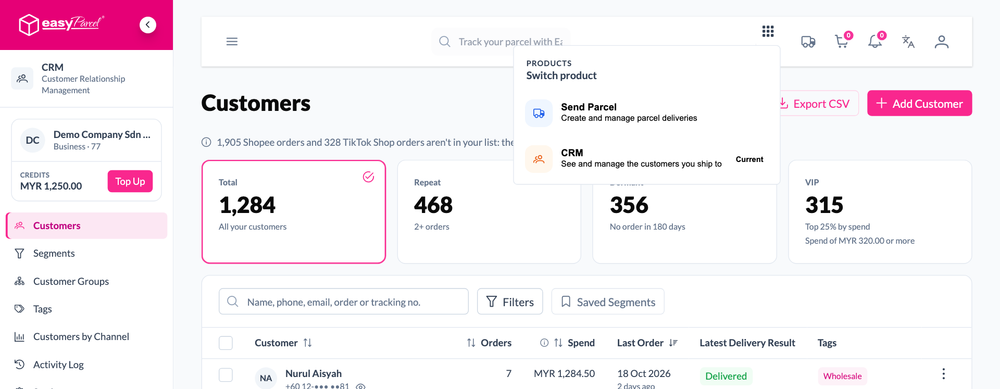

### Step 2: Switch on CRM

The first time you open CRM, it shows what CRM does and a **Switch On CRM** button.

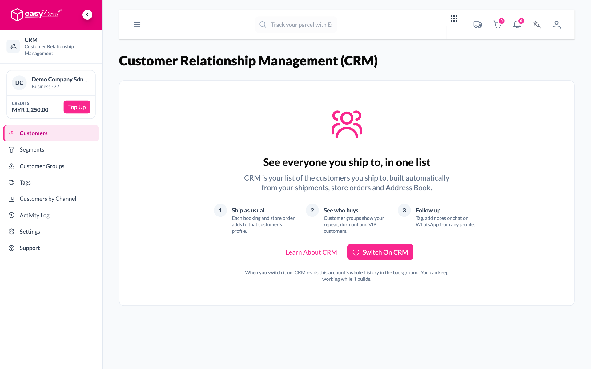

Only the **account owner** can switch CRM on. A team member sees *Ask your account owner to switch on CRM* instead, and can use CRM as soon as the owner has.

1. Click **Switch On CRM**.
2. Read the terms. They explain where your customer list is kept, who can see it, and your responsibilities for your customers' data.
3. Tick **I've read these terms, and I'm responsible for using my customers' data lawfully.**
4. Click **Agree & Switch On**.

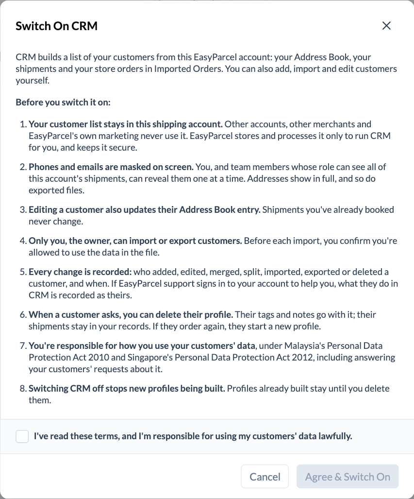

### Step 3: Wait for your customer list to build

CRM now reads your account's whole history in the background: your Address Book, your shipments and your store orders. Click **Go to Customers** to follow its progress.

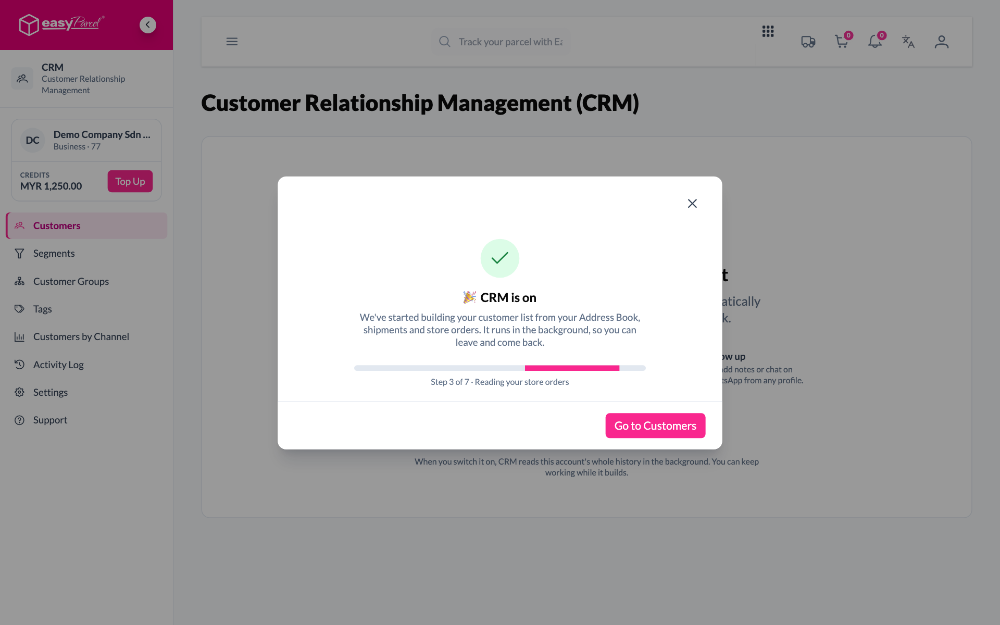

The build runs in **7 steps**. You can leave the page and keep working: it carries on without you. A large account can take a while.

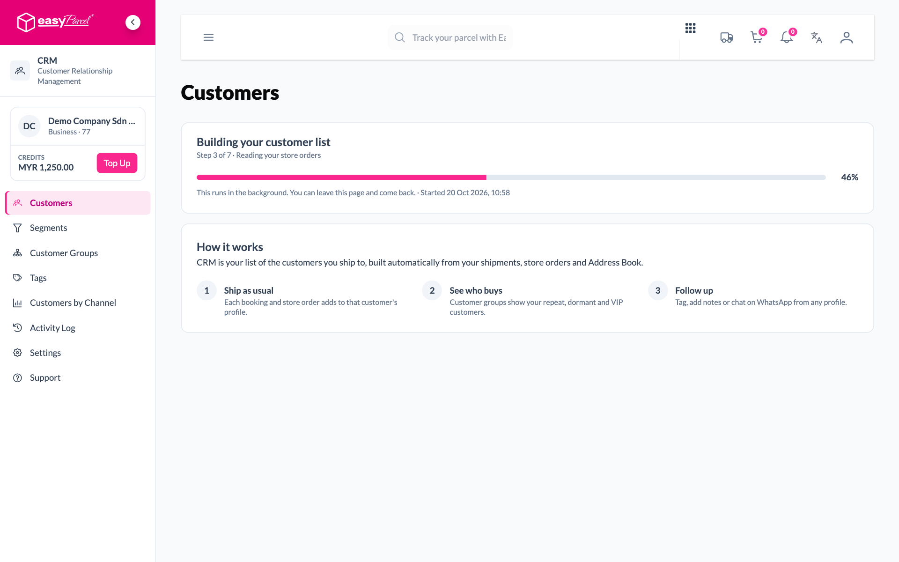

When it finishes, your list is ready. From then on, **new shipments and store orders appear within about 15 minutes**.

---

## Part 2 — The Customers page

The **Customers** page is your list of everyone you ship to.

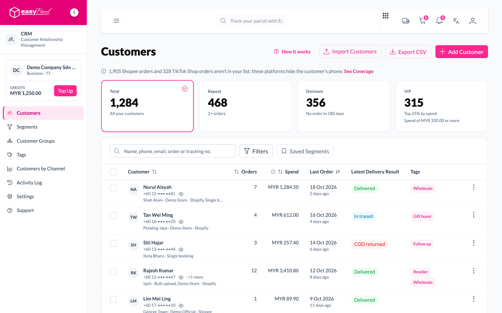

| Part of the page | What it does |
|---|---|
| **How it works** | Shows a short explanation of the page. Every CRM page has one. |
| **Import Customers** / **Export CSV** | Add customers from a file, or download your list. Only the account owner sees these. See [Part 7](#part-7--import-customers) and [Part 8](#part-8--export-customers). |
| **Add Customer** | Add one customer by hand. See [Part 4](#part-4--add-edit-merge-and-split-customers). |
| **Coverage line** | Tells you how many store orders aren't in your list, and why. Click **See Coverage** for the details. |
| **Group cards** | **Total**, **Repeat**, **Dormant** and **VIP**. Click a card to show only those customers. |
| **Search**, **Filters**, **Saved Segments** | Find the customers you want. |
| **The list** | Each customer's orders, spend, last order, latest delivery result and tags. Click a column header to sort by it. |

### Each row in the list

- **Name and phone.** Phones are masked, for example `+60 12-••• ••81`. Click the **eye** icon to show one number.
- **Under the phone:** the customer's city, then where they ordered from (a store or a booking method). Customers you added yourself say **Added by hand** or **Imported**.
- **Shared number:** this phone was used with many different names, as an office front desk or a reseller's agent would. It is still one customer, so check the name on each order.
- **No orders yet:** a saved receiver or a customer you added who hasn't ordered yet.
- **⋮ (More actions):** view the profile, copy the phone, and more.

### Why some store orders aren't in your list

CRM joins every order to a customer **by phone number**. Shopee, Lazada, TikTok Shop and Amazon hide the buyer's phone on most of their orders, so those orders can't join anyone. They are left out and counted, so you always know how many.

Click **See Coverage** to see, for each store and booking method, how many of its orders are in your list and why the rest were left out.

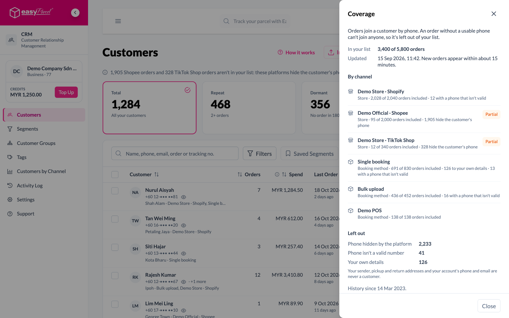

> Your own sender, pickup and return addresses, and your account's own phone and email, are never counted as a customer.

### Search

Type in the search box to find a customer by **name, phone, email, order number or tracking number**. The row says what matched, for example *Matches tracking no.*

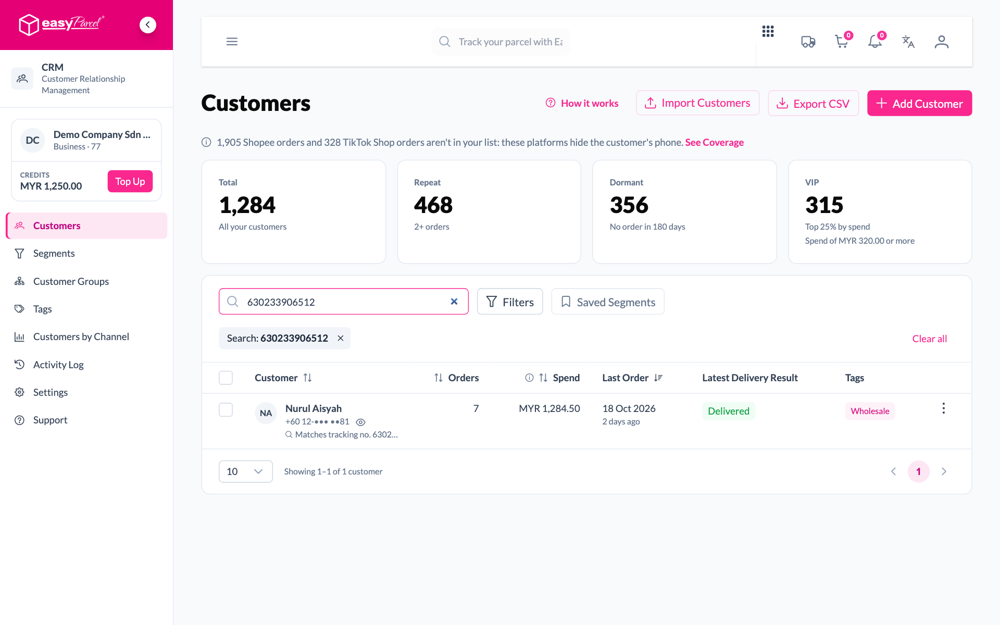

### Filters

Click **Filters**, choose what you need, then click **Apply Filters**. **Reset All** clears them.

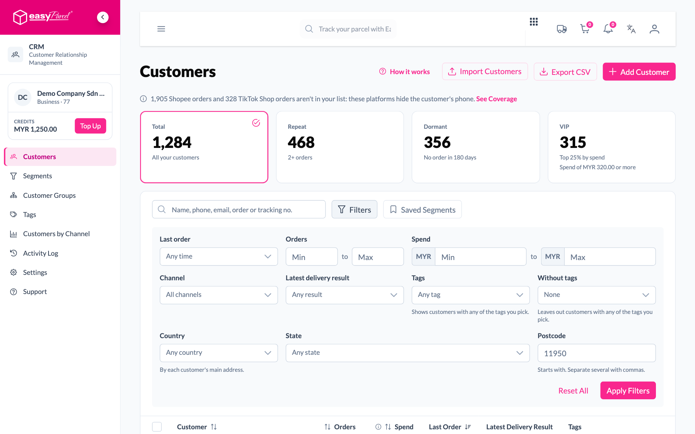

| Filter | Shows customers… |
|---|---|
| **Last order** | Who last ordered within 30, 90 or 180 days, more than 180 days ago, or in a custom range |
| **Orders** / **Spend** | With a number of orders, or a total spend, between a minimum and a maximum |
| **Channel** | Who ordered from one store or booking method, or whom you **added** or **imported** |
| **Latest delivery result** | Whose latest parcel was Delivered, In transit, Returned or COD returned, or who has no parcel yet |
| **Tags** | With **any** of the tags you pick |
| **Without tags** | Without any of the tags you pick |
| **Country**, **State**, **Postcode** | By their main address. Postcode matches the start, so `119` finds `11950`. Separate several postcodes with commas. |

Each filter you use shows as a chip above the list. Click **×** on a chip to remove it, or **Clear all** to remove them all.

### Customer groups and filters together

Click a **group card** and add filters to narrow it down. For example, **Repeat** customers who ordered from your Shopify store:

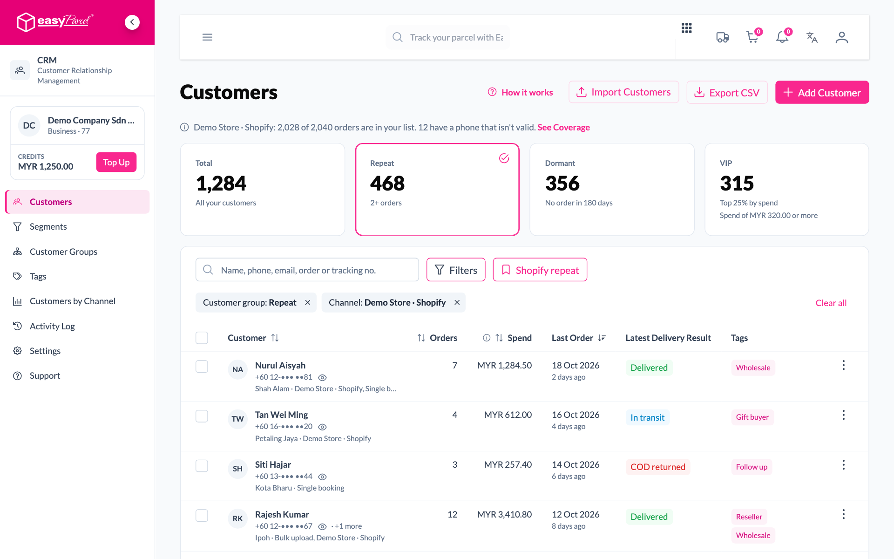

### Save a segment

A **segment** saves the customer group, filters and sort you are using, so you and your team can open the same list again in one click. Its count is always up to date.

1. Pick a customer group, filters or both.
2. Click **Saved Segments**, then **Save as Segment** (or click **Save as Segment** beside **Clear all**).
3. Give it a name and click **Save Segment**. Everyone on your team sees it.

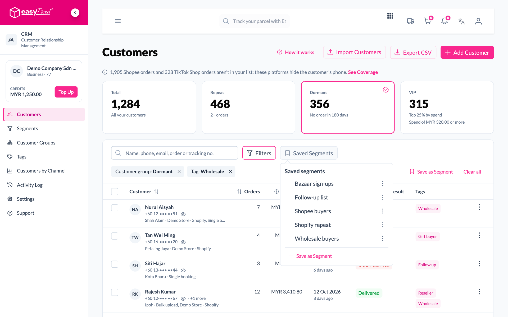

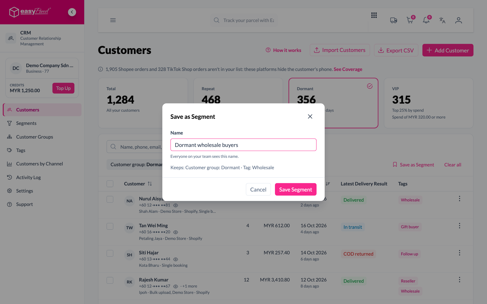

To open a saved segment, click **Saved Segments** and pick it. Use the **⋮** beside a segment to **Rename** it, **Update to Current Filters** or **Delete** it.

### Work on many customers at once

Tick the box beside each customer you want, or the box in the header to select the whole page (then **Select All** to include every page). A bar appears with:

- **Add Tags** and **Remove Tags**
- **Merge** (when two or more customers are selected; see [Part 4](#part-4--add-edit-merge-and-split-customers))
- **Clear** to unselect

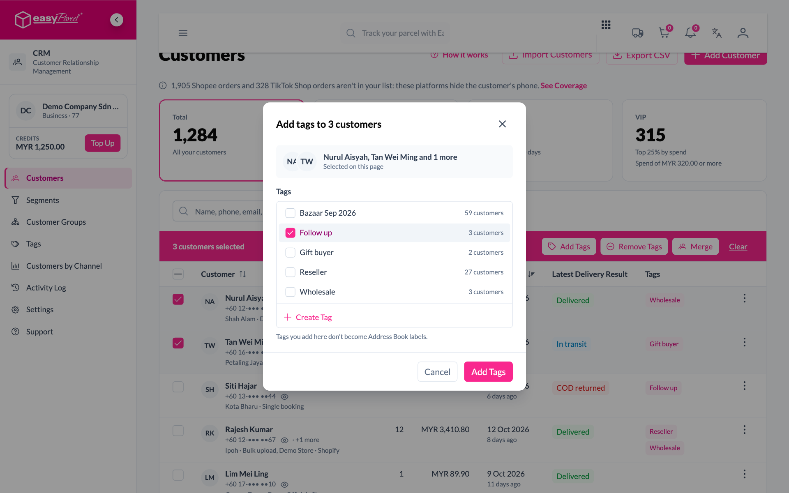

> Tags you add in CRM don't become Address Book labels.

---

## Part 3 — A customer's profile

Click a customer's name to open their profile.

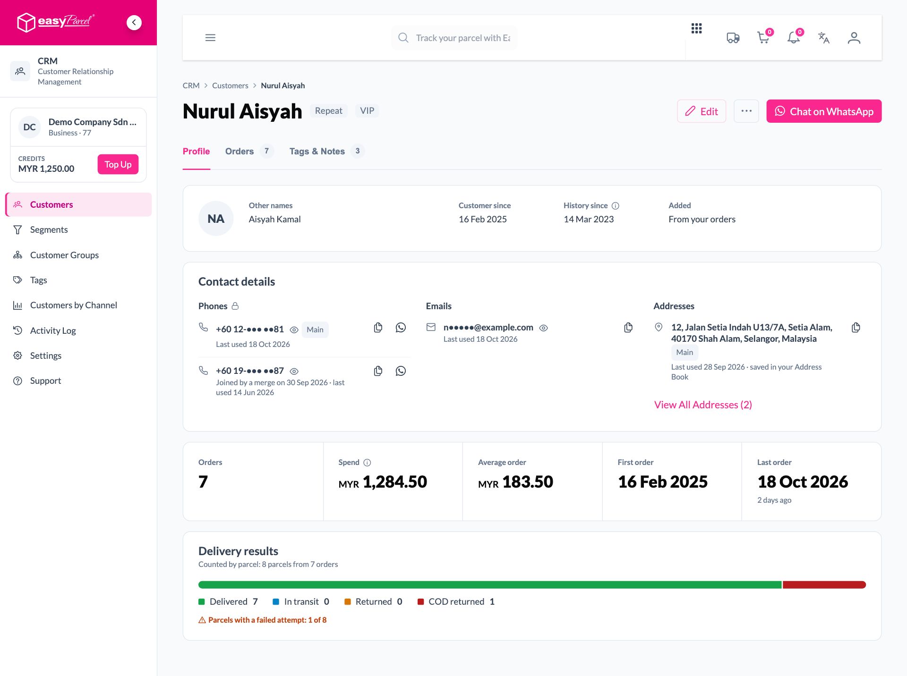

At the top:

- The customer's **groups**, for example **Repeat** and **VIP**.
- **Edit** to change their details.
- **⋯ (More)** for Merge, Split Customer, View Activity, Report a Problem and Delete Customer.
- **Chat on WhatsApp** opens a WhatsApp chat with the customer's main phone.

### Profile tab

| Section | What it shows |
|---|---|
| **Other names** | Other names this customer used on their orders |
| **Customer since** | Their first order or when they were added |
| **History since** | The earliest shipment CRM has for your account |
| **Added** | How the customer came in: from your orders, your Address Book, by hand or from an import |
| **Contact details** | Every phone, email and address they have used, main one first, with when each was last used. Use the **copy** icon to copy one, or the **WhatsApp** icon beside a phone to chat. |
| **Orders, Spend, Average order, First order, Last order** | Their key numbers |
| **Delivery results** | Their parcels by result: **Delivered**, **In transit**, **Returned** and **COD returned**, plus how many parcels had a **failed attempt** |

> **Phones can't be edited.** A phone is what identifies a customer. If someone changes their number, add a customer with the new number, then merge the two.

### Orders tab

Every order this customer has made, newest first. Filter by delivery result, channel or whether the order has a shipment yet. Click **>** on an order to see its parcels: the courier, tracking number, delivery result, any failed attempts, and the name, phone and address it was shipped to.

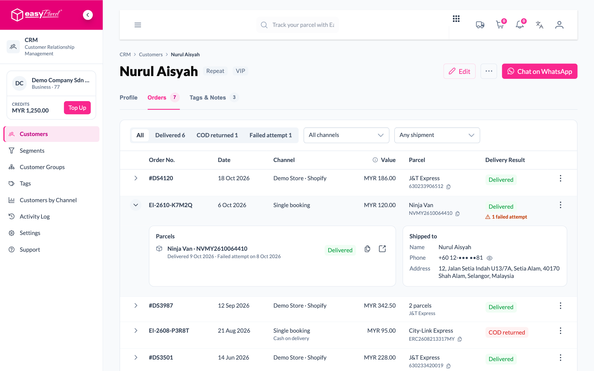

- A **failed attempt** is a delivery try that didn't reach the customer, for example nobody was home. The parcel may still be delivered later, so it is shown beside the result.
- A few couriers don't report failed attempts. Their parcels say **Not reported**.
- **Cash on delivery** is shown under the channel for COD parcels.
- Click the **open** icon on a parcel to go to its shipment.

### Tags & Notes tab

- **Tags:** click **Add Tag** to put a tag on this customer, or **×** to take one off.
- **Notes:** type a note and click **Add Note**. Each note shows who wrote it and when. Only your team sees notes. Click the **bin** icon to delete one.

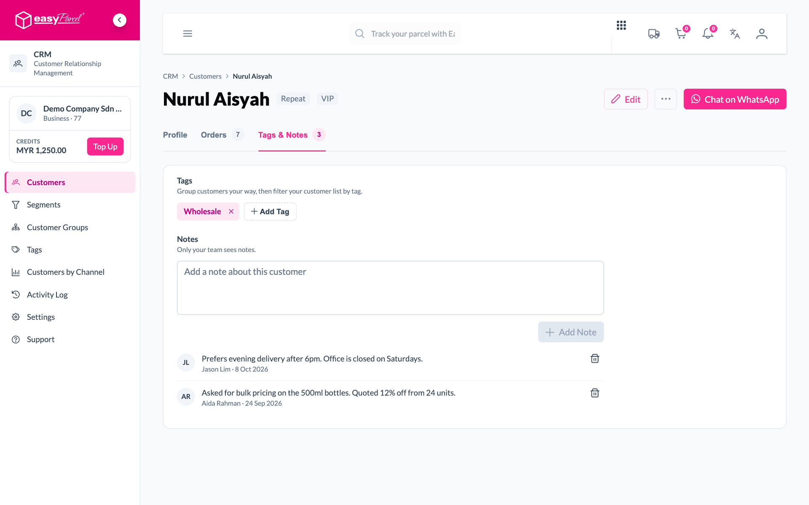

### More actions

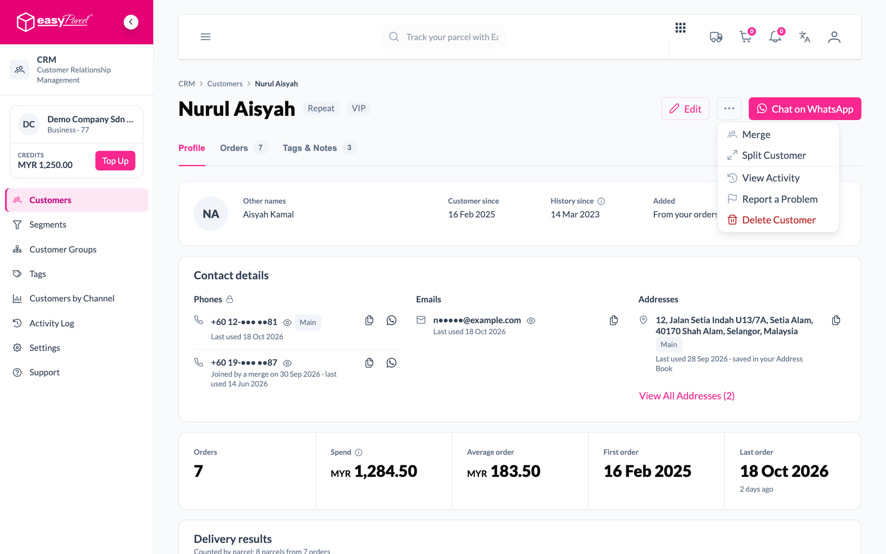

| Action | What it does |
|---|---|
| **Merge** | Combine this customer with others who are the same person. See [Part 4](#merge-customers). |
| **Split Customer** | Take a phone, with its orders, out into a customer of its own. Only shows when the customer has two or more phones. |
| **View Activity** | Opens the Activity Log for this customer only. |
| **Report a Problem** | Tell us the profile looks wrong (for example, two different people are mixed together). We use reports to improve how customers are matched. Sending one doesn't change the profile. |
| **Delete Customer** | Owner only. Deletes the profile, with its tags and notes, for example when the customer asks you to. Their shipments stay in your records. If they order again, they start a new profile. |

---

## Part 4 — Add, edit, merge and split customers

### Add a customer

1. On the **Customers** page, click **Add Customer**.
2. Enter the **Phone**. It is the only field you must fill in, and it can't be changed later.
3. Add a **Name** and **Company** if you have them.
4. Use **Emails**, **Addresses** and **Tags & Note** on the left to add more, now or later.
5. Click **Add Customer**.

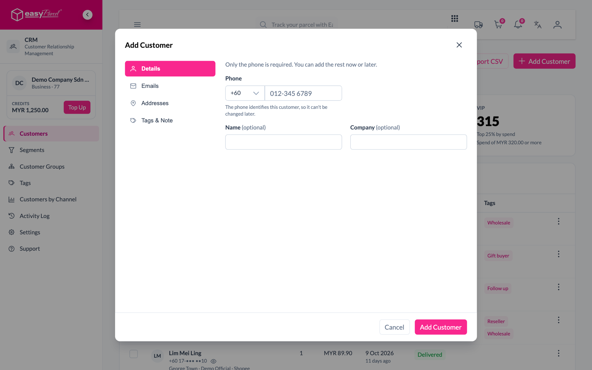

When you add an address, **Also save to Address Book** is ticked, so the address fills in when you book. It needs the customer's name, address line 1, postcode, city and state. Untick it to keep the address in CRM only.

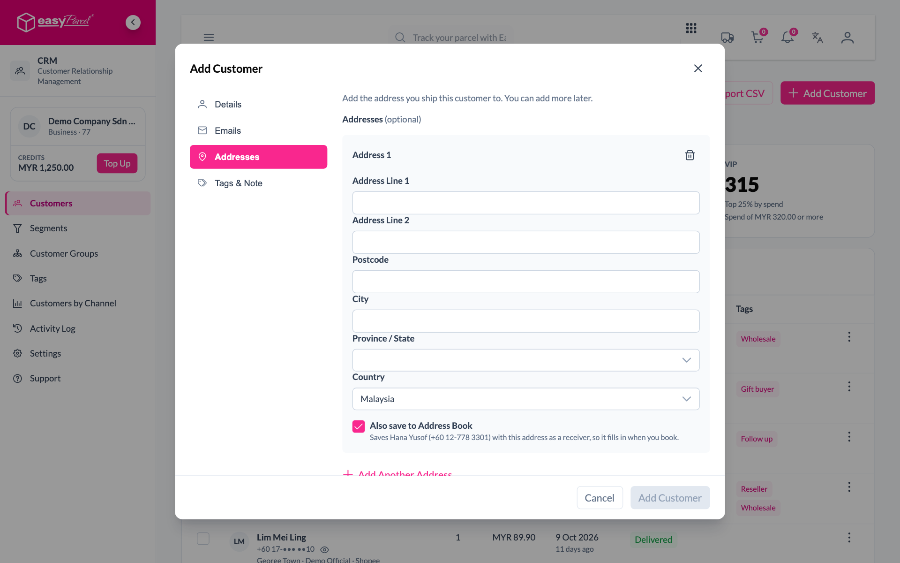

If the phone already belongs to a customer, CRM says so and links to that customer instead, because a phone can belong to only one customer.

### Edit a customer

Open the profile and click **Edit**.

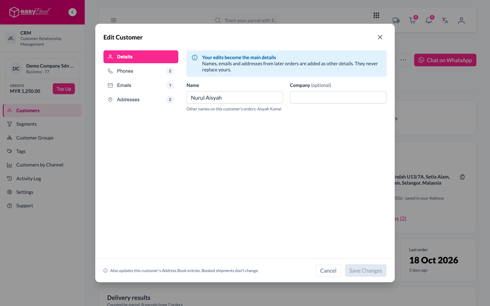

- **Your edits become the main details.** Names, emails and addresses from later orders are added as *other* details. They never replace yours.
- Editing also updates the customer's matching **Address Book** entries.
- **Shipments you've already booked never change.** New bookings use the new details.

### Merge customers

When two or more profiles are the same person, merge them. Their phones, orders, tags and notes come together in one profile, and **new orders to any of their phones land on the merged customer**.

1. Open one of the profiles and click **⋯ → Merge**. (Or, on the Customers page, tick two or more customers and click **Merge**.)
2. Search for the other customer and pick them.
3. Choose the **main profile**. Its name and details lead; the others' names, emails and addresses are kept as other details.
4. Optionally type a **Name after merging**.
5. Check **After merging**, then click **Merge Customers**.

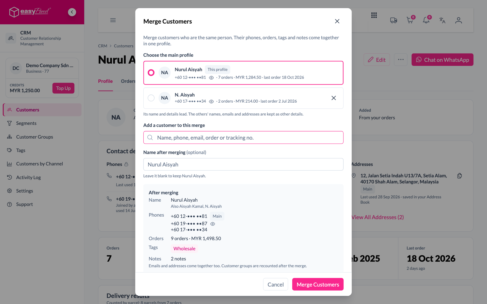

> Merged by mistake? Split a phone back out from the profile.

### Split a customer

When one profile holds two people, split one phone out.

1. Open the profile and click **⋯ → Split Customer**.
2. Choose the **phone to take out**.
3. Check what **stays** and what **becomes a new customer**, then click **Split Customer**.

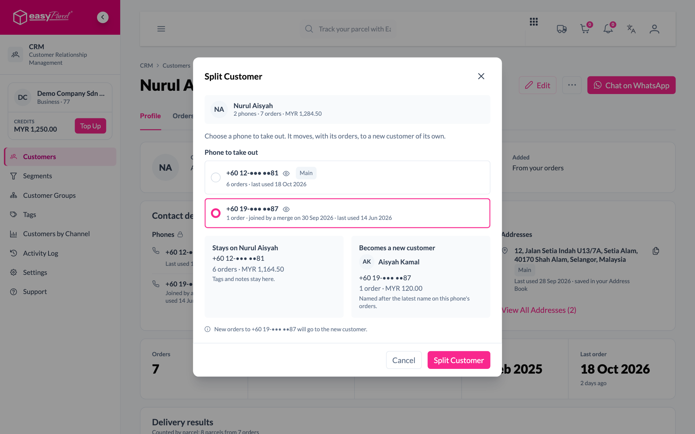

The phone moves, with its orders, to a new customer named after the latest name on that phone's orders. Tags and notes stay on the original profile. New orders to that phone go to the new customer.

### Move one order to another customer

If a single order belongs to someone else:

1. Open the profile's **Orders** tab.
2. Click **⋮** on the order and choose **Move Order**.
3. Pick the customer to move it to, check **After the move**, and click **Move Order**.

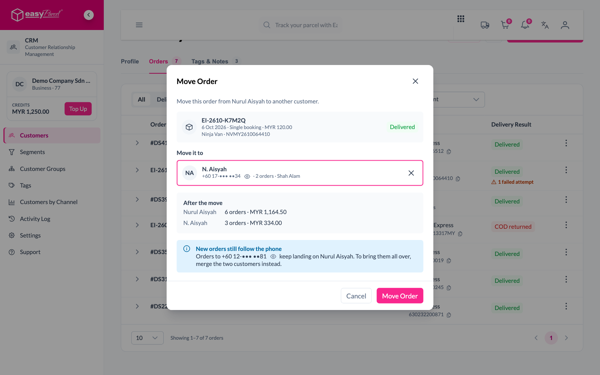

> New orders still follow the phone. To bring all of one phone's orders over, merge the two customers instead.

### Delete a customer

Owner only. Open the profile, click **⋯ → Delete Customer**, choose a reason and confirm.

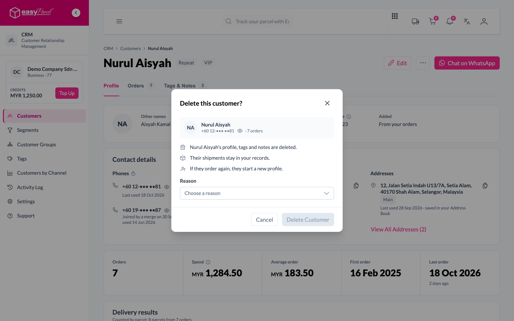

- The customer's profile, tags and notes are deleted.
- Their shipments stay in your records.
- If they order again, they start a new profile.

### Report a problem with a profile

If a profile looks wrong, click **⋯ → Report a Problem**, choose what looks wrong, add a comment if you like, and click **Send Report**.

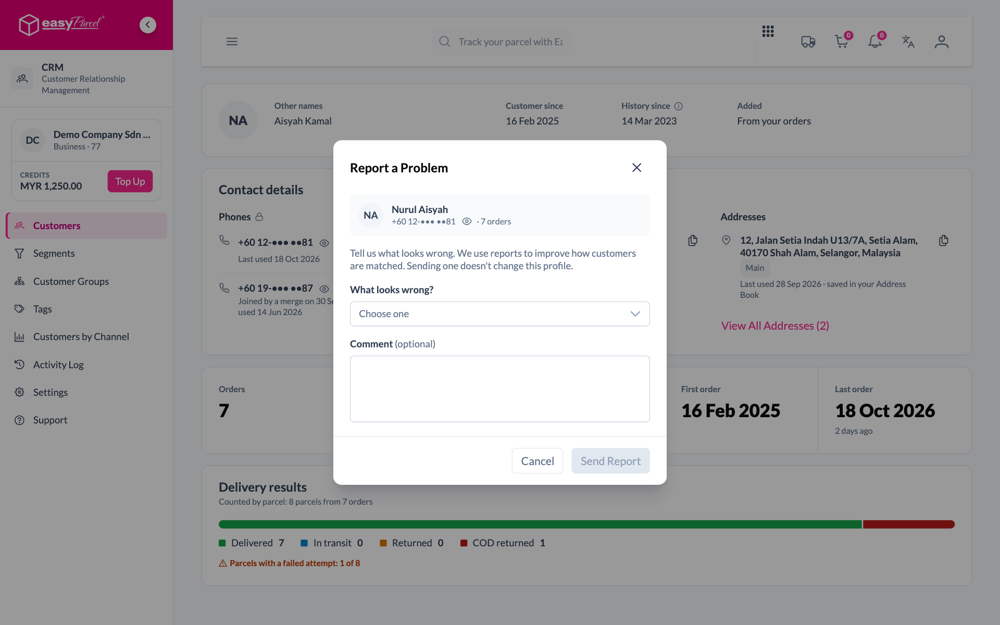

---

## Part 5 — Customer groups, segments and tags

### Customer Groups

Customer groups sort your customers by their order history. CRM checks again about every 15 minutes, and each customer joins every group their orders match.

| Group | Default rule |
|---|---|
| **Repeat** | 2 or more orders |
| **Dormant** | No order in 180 days |
| **VIP** | Your top 25% of customers by spend |

The account owner can change what each group means on the **Customer Groups** page, then click **Save Changes**. **Reset to Defaults** puts the default rules back. Switch **Show** off to hide **VIP** from your group cards and filters.

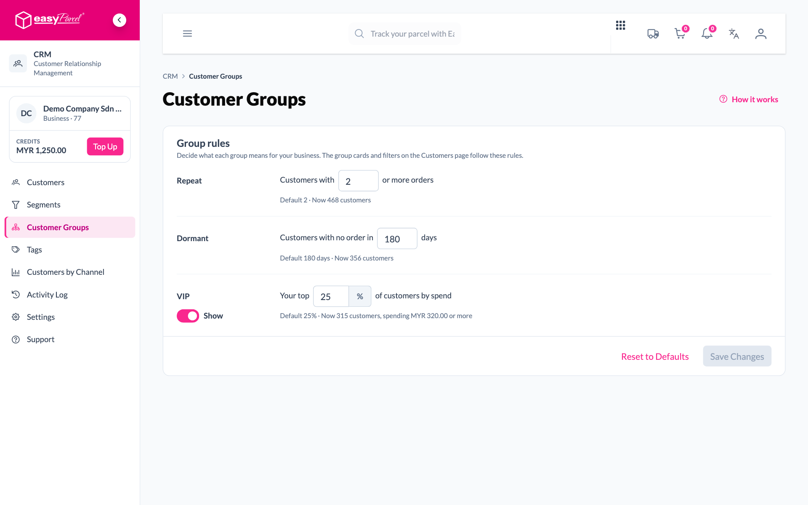

| Rule | Allowed values |
|---|---|
| Repeat | A whole number, 2 or more |
| Dormant | A whole number of days, 30 or more |
| VIP | A whole number from 1 to 100 (%) |

### Segments

The **Segments** page lists your team's saved segments, with how many customers match each one now. Click **View Customers** to open one, or **Create Segment** to go to the Customers page and build a new one.

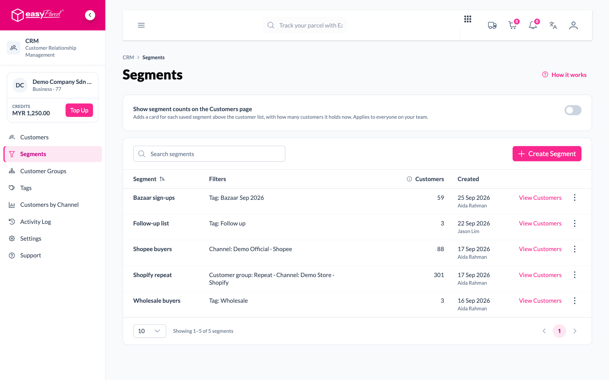

Switch on **Show segment counts on the Customers page** to add a card for each saved segment above the customer list. This applies to everyone on your team.

### Tags

A tag is a name you give customers yourself, such as *Wholesale* or *Follow up*, so you can find them again.

On the **Tags** page you can **Create Tag**, see how many customers have each tag, click **View Customers**, and use **⋮** to **Rename** or **Delete** a tag. Deleting a tag takes it off every customer; the customers stay.

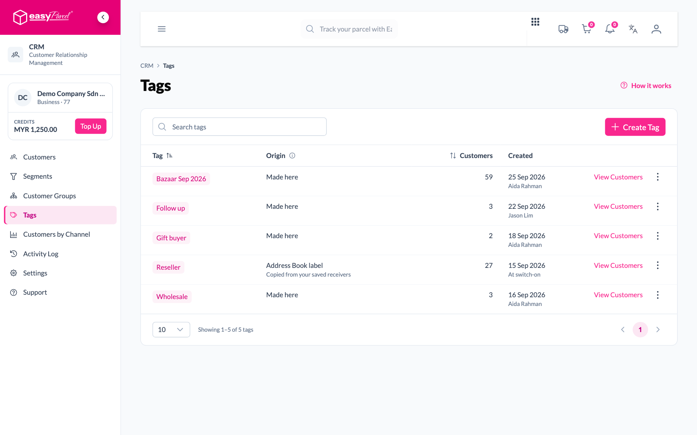

| Origin | Meaning |
|---|---|
| **Made here** | A tag you or your team created in CRM |
| **Address Book label** | Copied from the labels on your saved receivers, when CRM was switched on and whenever a saved receiver gets a new label. Renaming or removing it in CRM doesn't change your Address Book. |

---

## Part 6 — Customers by Channel

**Customers by Channel** shows which stores and booking methods your customers buy from, and how many of them come back.

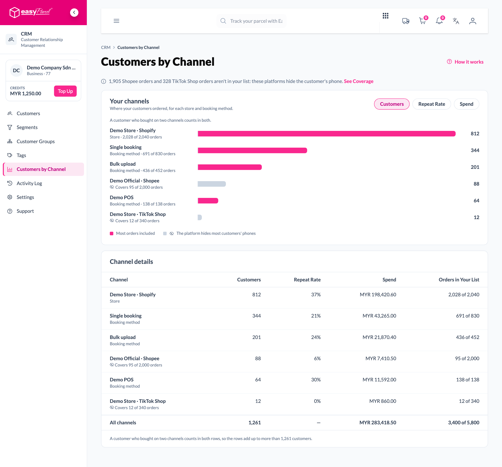

- Compare channels by **Customers**, **Repeat Rate** or **Spend**.
- A **grey bar** with *Covers 95 of 2,000 orders* means the platform hides most customers' phones, so the bar covers only some orders.
- A customer who bought on two channels counts in both.
- Click a channel to see its customers in your list.
- **Channel details** below shows every number in one table.

**Channels you may see**

| Channel | Meaning |
|---|---|
| *Store name · Platform* | A store you connected in Imported Orders, such as `Demo Store · Shopify` |
| **Single booking** | Parcels you booked one at a time |
| **Bulk upload** | Parcels you booked by bulk upload |
| **Mobile app** | Parcels booked from the EasyParcel mobile app |
| *App name* or **Other app** | Parcels booked from an app or your own system through the API |

---

## Part 7 — Import customers

Owner only. Import customers from a **CSV or Excel** file, such as a list you keep in a spreadsheet or one exported from another CRM.

> Import opens when your customer list has finished its first build, because it checks each phone against the customers you already have.

### Step 1: Upload your file

On the **Customers** page, click **Import Customers**. Drag your file in, or click **Choose File**.

- `.csv`, `.xlsx` or `.xls`, up to **50,000 rows** and **50 MB**.
- Row 1 holds the column names, and **every row needs a phone**.
- Not sure how to lay it out? Click **Download Template**.
- An Excel file with several sheets asks which sheet holds your customers.

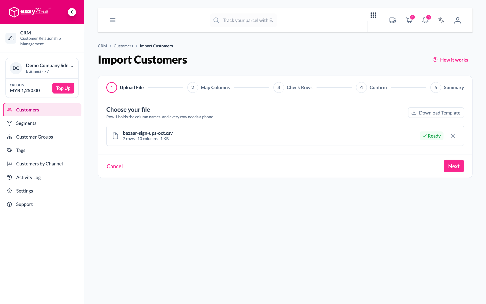

Click **Next**.

### Step 2: Map your columns

CRM matches your columns by their names. Check each one under **Imports As**, and change it if needed.

- **Phone** is required.
- Numbers without a country code get your account's country code (+60 or +65).
- Several tags in one cell? Separate them with commas. Tags you don't have yet are created.
- Set a column to **Don't import** to leave it out.

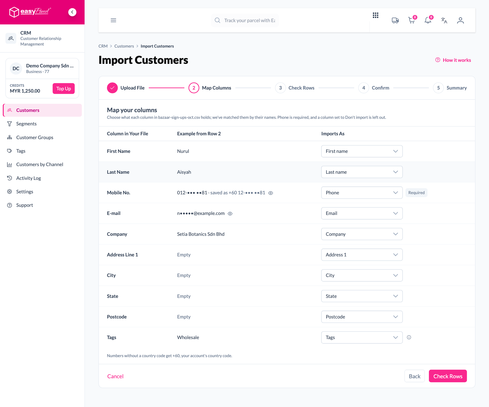

Click **Check Rows**.

### Step 3: Check the rows

CRM checks every row before anything is saved:

| Box | Meaning |
|---|---|
| **Will be added** | New customers |
| **Will be updated** | Phones already on file: blanks are filled in and tags are added. **Nothing is overwritten.** |
| **Will be skipped** | Rows with errors, listed below with the reason, such as a missing or invalid phone |

Click **Download Error Rows** to get the skipped rows in a file, fix them, and import them later.

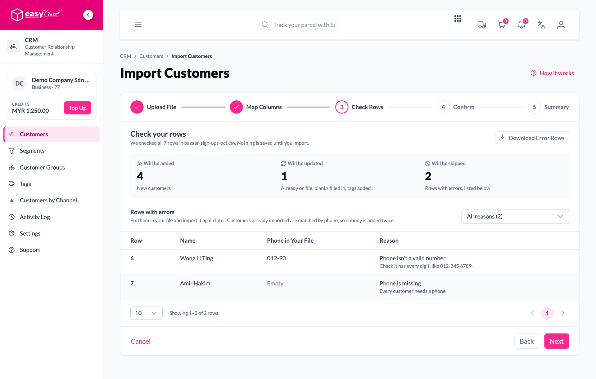

Click **Next**.

### Step 4: Confirm

1. Optionally, **Tag everyone in this import**, for example `Bazaar Oct 2026`, so you can find them later.
2. Tick **Also save to Address Book** if you want new customers with a complete address saved as receivers. It is off for imports.
3. Tick **I confirm I'm allowed to use the data in this file**.
4. Click **Import … Customers**.

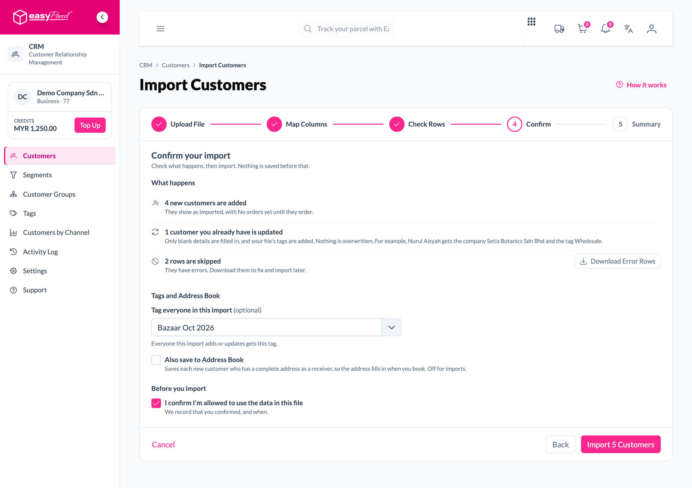

Rows are saved in batches of 1,000. **Keep the page open until it finishes.** If you leave, the import stops, and the rows already imported stay saved.

### Step 5: Summary

The summary shows how many customers were **added**, **updated**, **skipped** and **failed**. Click **View Imported Customers** to see them in your list.

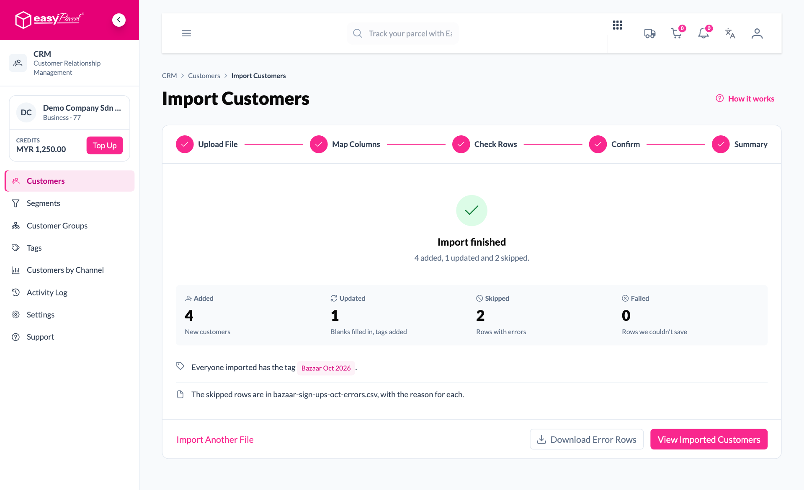

> You can import the same file again after fixing it. Phones already on file are matched, so nobody is added twice.

---

## Part 8 — Export customers

Owner only.

1. On the **Customers** page, pick the customer group, filters or search you want. The export is your list **as it's filtered now**.
2. Click **Export CSV**.
3. Check the count and columns, then click **Export … Customers**. The file downloads.

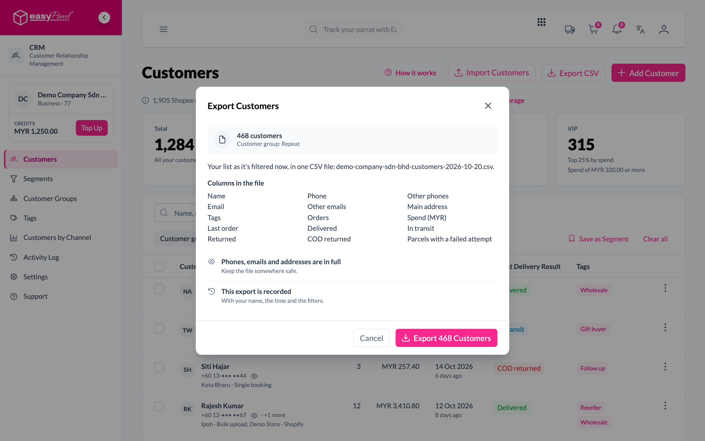

- Phones, emails and addresses are **in full** in the file. Keep it somewhere safe.
- Every export is **recorded** in the Activity Log, with your name, the time and the filters.
- One export holds up to 100,000 customers. For a longer list, narrow it first (for example with a customer group, a tag or **Last order**) and export each part.

---

## Part 9 — Activity Log and Settings

### Activity Log

The **Activity Log** shows who changed what in your CRM, and when: adding, editing, merging, splitting, moving, importing, exporting and deleting customers, tags, notes, segments and settings.

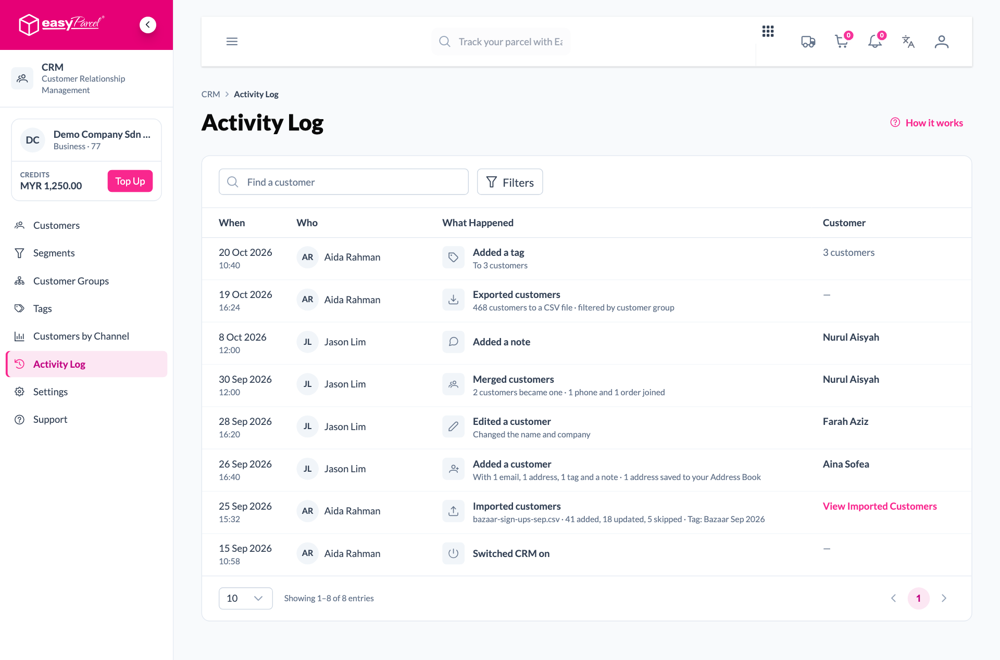

- The **account owner** sees everyone's activity. A **team member** sees only their own.
- Use **Find a customer** to see one customer's activity, or **Filters** to narrow by action, person and date.
- Anything EasyParcel Support does in your CRM while helping you is shown as **EasyParcel Support**.

### Settings

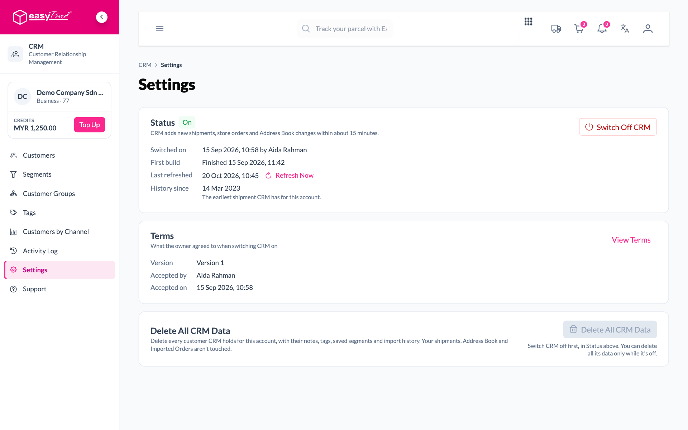

| Section | What it does |
|---|---|
| **Status** | Shows whether CRM is **On** or **Off**, when it was switched on, when the first build finished, the **Last refreshed** time and **History since**. |
| **Refresh Now** | Fetches new shipments and orders now, instead of waiting for the next update (about every 15 minutes). |
| **Switch Off CRM** | Stops adding new shipments, store orders and Address Book changes. Your profiles stay, with their tags and notes. To switch CRM on again, you agree to the terms again, and it catches up on everything since. |
| **Terms** | Which version of the terms the owner accepted, by whom and when. Click **View Terms** to read them. |
| **Delete All CRM Data** | Deletes every customer CRM holds for this account, with their notes, tags, saved segments and import history. Your shipments, Address Book and Imported Orders aren't touched, and the Activity Log stays. Only while CRM is off: switch it off first, then type the word shown to confirm. **This can't be undone.** |

Only the account owner can change Settings.

---

## Where your customers come from

CRM matches everything **by phone number**: one phone belongs to one customer in your account.

| Source | What it adds |
|---|---|
| **Address Book** | Your saved receivers, with their names, phones, emails, addresses and labels. A saved receiver who hasn't ordered yet is marked **No orders yet**. |
| **Shipments** | Every parcel you book: single bookings, bulk uploads and bookings from your apps. Each brings the receiver's details, the courier, the delivery result and any failed attempts. |
| **Store orders** | Orders from the stores you connected in **Imported Orders**, such as Shopify or Shopee, with each order's grand total. |
| **Customers you add** | Customers you add by hand or import from a file. They're marked **Added by hand** or **Imported**, and **No orders yet** until they buy or you ship to them. |

**How the numbers are counted**

- **Orders:** one order is one sale. A store order counts once however many parcels it took. A booking with no store order is one order.
- **Spend:** a store order adds its **grand total**. A booking adds the **declared parcel value as entered**. Only orders in your account's currency add to spend; orders in other currencies still count as orders.
- **Delivery results** count **parcels**, not orders.
- A cancelled store order stays in the customer's history but isn't counted.

---

## Who can do what

The account owner and team members can use CRM. A team member's role must be able to see **all of the account's shipments**, because CRM shows customers from the whole account. The owner sets this under **Team Management**.

| Action | Owner | Team member |
|---|---|---|
| Switch CRM on or off, accept updated terms | ✅ | — |
| View customers, search, filter, sort | ✅ | ✅ |
| Add, edit, merge and split customers, move orders | ✅ | ✅ |
| Add and remove tags, add and delete notes | ✅ | ✅ |
| Create and manage tags and saved segments | ✅ | ✅ |
| Reveal masked phones and emails | ✅ | ✅ |
| Import and export customers | ✅ | — |
| Delete a customer | ✅ | — |
| Change customer group rules and Settings | ✅ | — |
| Delete all CRM data | ✅ | — |
| Activity Log | Everyone's activity | Their own activity |

---

## Your customers' privacy

- **Your list stays in this account.** Other accounts, other merchants and EasyParcel's own marketing never use it.
- **Phones and emails are masked on screen** until you reveal one. Addresses show in full, and so do exported files.
- **Only the account owner imports or exports**, and confirms before each import that they're allowed to use the data in the file.
- **Every change is recorded** in the Activity Log.
- **The account owner can delete a profile when a customer asks.** Their tags and notes go too; their shipments stay in your records.
- You are responsible for how you use your customers' data, under Malaysia's Personal Data Protection Act 2010 and Singapore's Personal Data Protection Act 2012.

---

## Troubleshooting and FAQ

**I don't see CRM in the app menu.**
CRM is open to invited accounts. Contact us (see below) if you'd like it for your account. If your login has several accounts, check that you're on the right one.

**It says "CRM isn't available for your role".**
Your role sees only its own shipments, and CRM shows customers from the whole account. Ask your account owner to give your role access to all shipments under **Team Management**.

**It says "Ask your account owner to switch on CRM".**
Only the account owner can switch CRM on. You can use it as soon as they do.

**It says "Accept the updated terms to keep using CRM".**
The CRM terms have changed. CRM is paused until the account owner opens CRM and accepts them. Nothing is lost meanwhile: new shipments and store orders keep being added in the background.

**It says "CRM access has ended for this account".**
Your customer list, tags and notes are kept. Contact us if you'd like to keep using CRM.

**Some of my Shopee, Lazada, TikTok Shop or Amazon orders are missing.**
These platforms hide the buyer's phone on most orders, and CRM joins orders to customers by phone. Those orders are left out and counted. Click **See Coverage** on the Customers page to see how many for each store. An order that does carry a full phone is matched like any other.

**A new order isn't showing yet.**
New shipments and store orders appear within about 15 minutes. The account owner can click **Refresh Now** in **Settings**.

**One profile holds two different people.**
Split it: **⋯ → Split Customer**. If they share one phone, it stays one customer marked **Shared number**; check the name on each order.

**One person has two profiles.**
Merge them: **⋯ → Merge**.

**The spend doesn't match my store.**
For a booking, CRM adds the declared parcel value as you entered it, which may be a placeholder. For a store order it adds the grand total. Only orders in your account's currency add to spend.

**Why can't I see the full phone number?**
Phones and emails are masked on screen. Click the **eye** icon beside one to show it.

**Does editing a customer change my shipments?**
No. Shipments you've already booked never change. Edits also update the customer's matching Address Book entries, so new bookings use the new details.

**Does deleting a customer delete their shipments?**
No. Only the CRM profile, tags and notes are deleted.

**My import stopped partway.**
The rows already imported stay saved. Import the file again: phones already on file are matched, so nobody is added twice.

**The list is too long to export.**
One export holds up to 100,000 customers. Narrow the list with a customer group, a tag or **Last order**, then export each part.

**Will my customer list keep updating if I switch CRM off?**
No. Switching off stops new profiles being built, but your existing profiles stay until you delete them. Switch it on again and it catches up on everything since.

---

## Need help?

Click **Support** in the left menu of CRM, or WhatsApp us at **+604-2023160**.
